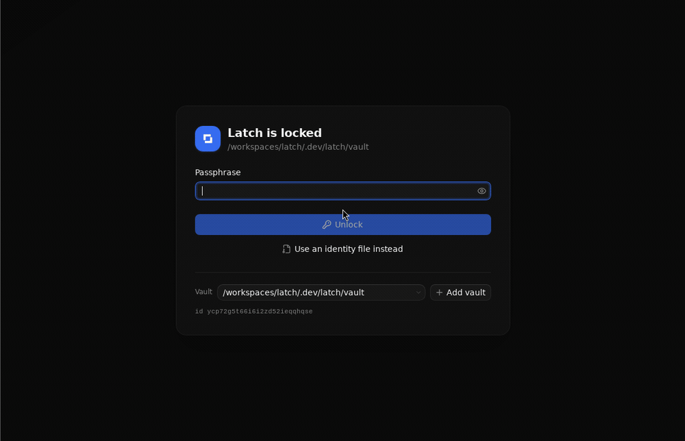

# Latch

Local, Git-backed secrets for developers. One encrypted vault, a desktop app, a CLI, and isolated project browsers. No account or hosted service.



- Encrypted profiles, logins, API keys, environment variables, history and sharing.
- Managed Firefox with workspace logins in its native password manager; one-way sync from Latch.
- One Rust core; desktop and CLI share the [Protobuf interface](packages/rpc/proto/latch/v1/agent.proto).

[**Download Linux x86_64**](https://github.com/nicksan222/latch/releases) · [Report a vulnerability privately](https://github.com/nicksan222/latch/security/advisories/new) · [MIT](LICENSE)

Linux packages require glibc 2.36+. macOS builds from source. CI covers Linux/macOS on x86_64 and arm64.

## Develop

Node 24+, npm 11+, and the pinned Rust toolchain. Use the Dev Container for native Linux dependencies; macOS needs Xcode Command Line Tools.

```sh
npm ci
npm run dev          # Isolated demo in your browser
npm run desktop:dev  # Native app
npm run cli -- status
npm run check:all    # Full quality gate
```

Edit `.proto`, then `npm run gen:protocol`. Project agent skills live in [`.agents/skills`](.agents/skills).

**Early release, not independently security-audited.** Keep backups. Git exposes metadata; removed recipients retain old history. Same-user malware can access unlocked secrets. Browser isolation is not an OS security boundary, and browser updates are maintainer-controlled.
